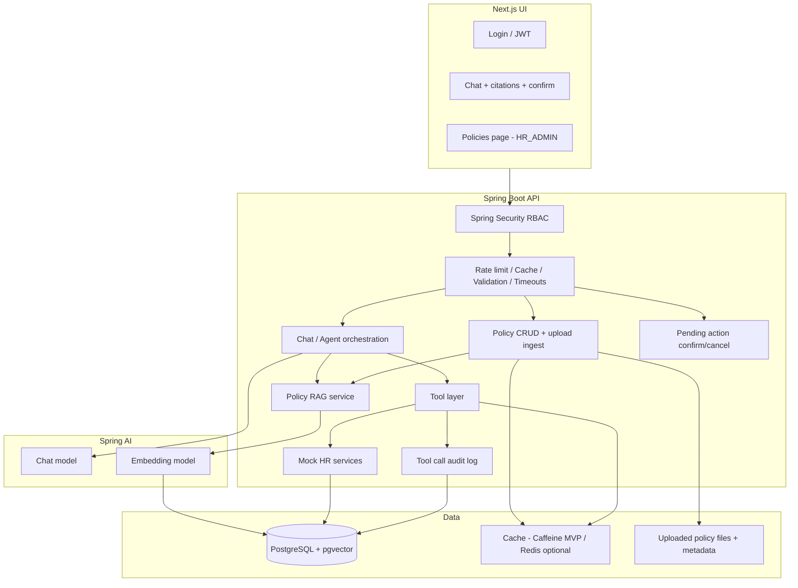

# HR Policy Assistant + Action Agent — Project Plan (v3)

Portfolio / interview project: **RAG over a configurable HR policy library** plus an **action agent** with tool calling, RBAC, and user confirmation for write operations.

> **Confidentiality:** Do not use any real employer code/data. Use **mock APIs**, **fictional company names** (e.g. Acme Corp), and **policy documents you author or upload**.

> **Changes from v2:** policies are **not** hardwired to leave/travel; full REST surface (auth, chat, policies, actions); folder layout locked in guides; **Phase 2.5** dedicated to folder refactor before RAG; admin **Policies** UI in Phase 3; **rate limit, cache, validation, LLM timeouts, observability** in §8.1 / Phase 5.

---

## 1. Vision

| Capability | Description |
|------------|-------------|
| **Policy library (generic)** | HR admin uploads a policy file **with a display name**. System chunks → embeds → stores in pgvector. Chat answers **from whatever is indexed** — leave, travel, WFH, expense, code of conduct, or any future doc. No fixed “policy type” enum required. |
| **RAG** | `searchHrPolicies` retrieves top-k chunks + metadata; UI shows **server-built citations**. |
| **Agent** | Tools: `getLeaveBalance`, `applyLeave`, `getHolidayList`, `searchHrPolicies` (optional `raiseHelpdeskTicket`). Leave/holiday tools talk to **systems of record**; policy Q&A talks to the **library**. |
| **Example** | Admin uploads “WFH Policy 2026” → employee asks *"Can I work from home on Fridays?"* → answer + citation from that upload. Separate example: *"Mere kitne leaves bache hain aur kal ka apply kar do"* → balance tool + pending apply. |
| **Stack** | Spring Boot + Spring AI, pgvector, Spring Security (RBAC), Next.js (JS) multi-page UI. |

**Why this is strong for interviews:** configurable knowledge base + RAG + tool calling + RBAC + **measured quality**. You can explain **upload → ingest → retrieve → cite**, not only static markdown in git.

---

## 2. High-level architecture



**Separation of concerns:**

1. **Policy library APIs** — create/list/get/delete/upload/re-ingest (admin). Topic-agnostic.
2. **Chat / agent API** — natural language; may call RAG + mock-HR tools.
3. **Action APIs** — confirm/cancel gated writes (Phase 4).

---

## 3. Repository layout

| Path | Purpose |
|------|---------|
| `backend/` | Spring Boot host — folder shape mirrors layered microservice layout (**structure only**; still Java/Spring, not ASP.NET) |
| `frontend/` | Next.js — folder shape mirrors modular Next.js layout (**structure only**; App Router + JS, Redux optional later) |
| `docs/policies/` | Optional seed/sample markdown for demos and eval |
| `docs/FRONTEND-ARCHITECTURE-GUIDE.md` | Frontend folder-structure reference |
| `docs/BACKEND-ARCHITECTURE-GUIDE.md` | Backend folder-structure reference |
| `eval/` | Retrieval and agent evaluation sets + runner |
| `docker-compose.yml` | PostgreSQL + pgvector |
| `README.md` / `PROJECT_PLAN.md` | Setup + this plan |

> **Important:** The guides define **folder / request-flow conventions**, not the runtime stack. This project stays **Spring Boot + Next.js + Gemini + pgvector**.

### 3.1 Frontend structure (locked — modular Next.js pattern)

**Mental model**

```text
app/<module>/page.js                 thin route: layout + mount screen
        ↓
src/component/<module>/...           UI screens (local state OK)
        ↓
store/<module>/<module>Actions.js    feature actions (thunk-style async fns)
        ↓
utils/api.js + commonRequest         authenticated HTTP
        ↓
utils/apiRoutes/<module>Routes.js    path fragments
        + routesMapping + Route()    prepend API base
        ↓
Backend REST
```

**Target tree**

```text
frontend/
  app/                                 # URL routes (Next App Router)
    login/page.js
    chat/page.js
    policies/page.js                   # HR_ADMIN — list + upload
    layout.js
    page.js
  src/
    component/                         # UI by module
      auth/
      chat/
      policies/
      common/                          # shared dialogs, loaders
      layout/
    configuration/
      AppSetting.js                    # env → API base URL
  store/                               # feature actions (+ optional reducers later)
    auth/
      authActions.js
    chat/
      chatActions.js
    policies/
      policiesActions.js
    actions/                           # pending-action confirm/cancel module
      actionsActions.js
  utils/
    api.js                             # http client + auth header (≈ apiWithAuth)
    helpers.js                         # commonRequest(url, body, method, params)
    apiRoutes/
      index.js                         # routesMapping + Route()
      authRoutes.js
      chatRoutes.js
      policiesRoutes.js
      actionsRoutes.js
  jsconfig.json                        # aliases: @component, @store, @utils, @configuration
  public/
  package.json
```

**Rules (from guide)**

- Pages stay **thin** — no direct API calls in `app/**/page.js`.
- Centralize URLs in `utils/apiRoutes` + `routesMapping`; never hardcode hosts in actions.
- Prefer `commonRequest` + authenticated client for all Spring calls.
- Mirror backend controller/action names in route constant names where practical.

**`utils/apiRoutes` → backend contract**

| Module file | Export example | Method | Backend path |
|-------------|----------------|--------|--------------|
| `authRoutes.js` | `Login` | POST | `/api/auth/login` |
| `authRoutes.js` | `Me` | GET | `/api/me` |
| `chatRoutes.js` | `Send` | POST | `/api/chat` |
| `policiesRoutes.js` | `List` | GET | `/api/policies` |
| `policiesRoutes.js` | `Get` | GET | `/api/policies/{id}` |
| `policiesRoutes.js` | `Upload` | POST | `/api/policies` (multipart: name + file) |
| `policiesRoutes.js` | `Delete` | DELETE | `/api/policies/{id}` |
| `policiesRoutes.js` | `Ingest` | POST | `/api/policies/{id}/ingest` |
| `actionsRoutes.js` | `Confirm` | POST | `/api/actions/{id}/confirm` |
| `actionsRoutes.js` | `Cancel` | POST | `/api/actions/{id}/cancel` |

```js
// utils/apiRoutes/index.js (shape)
export const routesMapping = {
  auth: authRoutes,
  chat: chatRoutes,
  policies: policiesRoutes,
  actions: actionsRoutes,
};
export const Route = (path) => `${ApiRootUrl}${path}`;
```

### 3.2 Backend structure (locked — layered API / application pattern)

**Mental model**

```text
HTTP → JWT → thin Controller (web)
         → Application feature Query/Command (or Service)
         → domain / mockhr / rag / agent
         → Response DTO
```

**Target tree** (single deployable Spring Boot app; folders mirror API vs Application split)

```text
backend/
  src/main/java/com/acme/hrassistant/
    HrAssistantApplication.java
    web/                               # ≈ <Name>.API — HTTP only
      AuthController.java
      MeController.java
      ChatController.java
      PolicyController.java
      ActionController.java
      dto/
      GlobalExceptionHandler.java
    application/                       # ≈ <Name>.Application — business by feature
      auth/
      chat/
      policies/
        queries/                       # list/get style reads
        commands/                      # upload/delete/ingest writes
      actions/
        commands/
      leave/                           # mock-HR leave balance / apply (later)
      holidays/
    agent/                             # @Tool methods + orchestration helpers
    rag/                               # ingest, chunk, embed, search
    mockhr/                            # fake HR services
    domain/                            # JPA entities + repositories
    security/                          # JWT, filters, SecurityConfig
    config/                            # beans, seed, AI, cache, rate-limit
      cache/
      ratelimit/
  src/main/resources/
    application.yml
  pom.xml
  Dockerfile
```

**Rules (from guide, adapted to Spring)**

| Layer | Put here | Do NOT put here |
|-------|----------|-----------------|
| `web/` | Controllers, DTOs, exception handler | SQL, RAG, leave rules |
| `application/<feature>/` | Use-cases (query/command or services) | HTTP routing details |
| `domain/` | Entities, repositories | Controllers |
| `rag/` / `agent/` / `mockhr/` | Cross-cutting domain engines | Random UI concerns |
| `config/cache`, `config/ratelimit` | Platform concerns (cache, Redis optional, pipeline filters) | Feature business rules |

- Controllers stay **thin**: bind input → call application layer → return DTO.
- Feature folders under `application/` grow with policies, chat, actions (CQRS-style naming even without MediatR).

### 4. Backend — logical modules

| Module / package | Responsibility |
|------------------|----------------|
| `security` | JWT login; roles `EMPLOYEE`, `HR_ADMIN`; method-level security |
| `domain` | `Employee`, `LeaveBalance`, `LeaveRequest`, `Holiday`, `PolicyDocument`, `PendingAction`, `ToolCallLog`, `ChatConversation` |
| `mockhr` | Fake HR APIs (leave/holiday) |
| `rag` | Ingest uploaded/seed docs → chunk → embed → pgvector; search |
| `agent` | System prompt, `@Tool` methods, orchestration, iteration limit |
| `application/actions` | Pending actions confirm/cancel |
| `application/policies` | Upload/list/delete/ingest use-cases |
| `web` | REST controllers only |

### 4.1 REST endpoints (target)

| Method | Path | Role | Purpose |
|--------|------|------|---------|
| POST | `/api/auth/login` | Public | JWT |
| GET | `/api/me` | `EMPLOYEE+` | Current user profile |
| POST | `/api/chat` | `EMPLOYEE+` | Agent message (`conversationId`); reply + citations + pending actions |
| GET | `/api/policies` | `EMPLOYEE+` | List policy metadata |
| GET | `/api/policies/{id}` | `EMPLOYEE+` | Policy metadata |
| POST | `/api/policies` | `HR_ADMIN` | Upload: **name** + file → store + ingest |
| DELETE | `/api/policies/{id}` | `HR_ADMIN` | Remove document + vector chunks |
| POST | `/api/policies/{id}/ingest` | `HR_ADMIN` | Re-index one policy |
| POST | `/api/admin/policies/ingest-all` | `HR_ADMIN` | Optional: re-index all |
| POST | `/api/actions/{id}/confirm` | `EMPLOYEE+` | Execute pending write |
| POST | `/api/actions/{id}/cancel` | `EMPLOYEE+` | Discard pending write |

**Rule:** Chat is **one** client. Policy management and actions are first-class APIs with matching `apiRoutes` + `store` modules on the frontend.

### 4.2 Standard response envelope

All JSON endpoints return:

```json
{
  "code": 1,
  "data": {},
  "message": "Success",
  "count": null
}
```

| Field | Meaning |
|-------|---------|
| `code` | **1** = success, **0** = failure |
| `data` | Payload (or `null` on failure) |
| `message` | Success or error text |
| `count` | Optional (list totals); omitted/`null` when unused |

Frontend `commonRequest` unwraps `data` and throws when `code === 0`.

---

## 5. Agent tools

| Tool | Type | Behavior |
|------|------|----------|
| `searchHrPolicies` | RAG | Top-k chunks across **all indexed policies** + metadata for model and UI citations |
| `getLeaveBalance` | Read | Logged-in employee only |
| `getHolidayList` | Read | Filter by year/month |
| `applyLeave` | Write (gated) | Validates rules → **pending action** → apply on confirm |
| `raiseHelpdeskTicket` | Write (gated) | **Optional.** Keep only to show the confirmation pattern generalizes |

### 5.1 Validation in code (not only in the prompt)

Notice period, leave type, balance, blackout dates, max consecutive days. These are **pure Java rules** with unit tests. They apply to **leave tools**, not to arbitrary uploaded policy text.

### 5.2 Tool security rules

- **`employeeId` comes only from the JWT / security context.** It is never a tool parameter the LLM can fill in.
- Every tool call is written to `ToolCallLog` (employee, tool, input, output, timestamp, conversationId).

### 5.3 Agent safety

- **Max iterations limit** on the tool-calling loop.
- **Audit log** of every tool call.
- Read tools run directly; **all writes** go through pending actions.

---

## 6. RAG and citations (upload-first)

### 6.1 Policy document model

Each upload creates a `PolicyDocument` (or equivalent):

| Field | Notes |
|-------|--------|
| `id` | UUID |
| `name` | Admin-chosen display name (e.g. “WFH Policy 2026”) — **not** limited to leave/travel |
| `sourceFileName` | Original filename |
| `contentType` | e.g. `text/markdown`, `application/pdf` (MVP: markdown/text first; PDF optional) |
| `storagePath` or blob | Where raw bytes live |
| `status` | `PENDING` / `INDEXED` / `FAILED` |
| `effectiveDate` | Optional |
| `grade` / `location` | Optional metadata filters |
| `uploadedBy` / `createdAt` | Audit |

**No required taxonomy.** Leave and travel are just example names; the library accepts any policy.

### 6.2 Ingestion

1. Accept upload (or seed from `docs/policies/` on empty store for demos).
2. Split by headings; target chunk size ~500–800 tokens.
3. Metadata per chunk: `policyId`, `policyName`, `section`, `sourceFile`, `effectiveDate`, `grade`, `location`.
4. Embed and store in **pgvector** via Spring AI `PgVectorStore`.
5. On delete/replace: remove old chunks for that `policyId`, then re-ingest.

### 6.3 Seed corpus (for eval / empty-DB demos)

Keep **10–15 sample files** under `docs/policies/` (versions, grade/location rules, overlaps) so retrieval eval still works without manual uploads. Uploads are the **product path**; seed files are **bootstrap + eval**.

### 6.4 Query

- Similarity search over the full library; optional metadata filter from employee grade/location.
- Instruction: **only answer from provided context; say so if context lacks the answer**.

### 6.5 Citations

- Built **server-side** from retrieval metadata (`policyName`, section, snippet). Model never invents a source name.

### 6.6 Chat response shape (conceptual)

```json
{
  "conversationId": "uuid",
  "message": "Per the WFH Policy 2026, Fridays are allowed with manager approval...",
  "citations": [
    {
      "source": "WFH Policy 2026",
      "section": "Eligible days",
      "snippet": "..."
    }
  ],
  "pendingActions": []
}
```

### 6.7 Ingestion triggers

- Admin **upload** → ingest immediately.
- Admin **re-ingest** / delete.
- Startup: if vector store empty, optionally seed from `docs/policies/`.

---

## 7. Chat + confirmation flow

**Example:** *"Kitne leaves bache hain aur kal ka apply kar do."*

1. Client sends message + `conversationId` with JWT → backend resolves `employeeId` from the token.
2. Agent calls `getLeaveBalance` → includes balance in reply.
3. Agent calls `applyLeave` → backend validates → returns **pending action** (no DB write yet).
4. UI shows **Confirm / Cancel** (via chat UI and/or `actionApi`).
5. `POST /api/actions/{id}/confirm` → backend **re-validates**, persists leave via mock HR → success.

**Policy Q&A example:** after admin uploads any named policy, employee asks a question → `searchHrPolicies` → answer + citations. No leave/travel restriction.

**Rule:** Read-only tools run without confirmation; all writes require explicit user confirmation.

### 7.1 Confirmation hardening

On `confirm`, the backend must:

- Verify the pending action **belongs to the authenticated user**.
- Verify it is **not expired** and still `PENDING`.
- Load the payload **from the server-side record**, never from the client.
- **Re-run validation**.
- Be **idempotent**.

---

## 8. Spring Security (RBAC)

| Role | Permissions |
|------|-------------|
| `EMPLOYEE` | Chat, list/read policy metadata, own balance/leave, own pending actions |
| `HR_ADMIN` | Above + upload/delete/re-ingest policies; optional view all tickets |

- JWT in `Authorization: Bearer`.
- Demo: token in memory or `sessionStorage`.
- Identity for tools and retrieval filters always from the security context.

---

## 8.1 Cross-cutting platform concerns

Same *ideas* as the microservice guide (cached GETs, Redis, CORS, validation filters, pipeline order) — implemented with Spring Boot primitives. **Not** ASP.NET attributes.

### Rate limiting

| Endpoint class | Limit idea (MVP) | Key |
|----------------|------------------|-----|
| `POST /api/auth/login` | Strict (e.g. 10 / min) | Client IP |
| `POST /api/chat` | Moderate (e.g. 20 / min) | Authenticated `employeeId` (fallback IP) |
| `POST /api/policies` upload / ingest | Low (e.g. 5 / min) | `employeeId` |
| Other authenticated GETs | Generous or none | — |

- Return **429** with a clear body when exceeded (wire into `GlobalExceptionHandler`).
- Prefer **Bucket4j** or **Resilience4j RateLimiter** filter/interceptor under `config/ratelimit/`.
- Protects Gemini quota and demos from accidental loops.

### Caching

| What | Strategy | TTL idea | Invalidate when |
|------|----------|----------|-----------------|
| `GET /api/policies` list | Spring Cache | ~1–5 min | Upload / delete / re-ingest |
| Holiday list (mock HR) | Spring Cache | hours / day | Seed change (rare) |
| Leave balance | **Do not cache** long (or very short) | — | Must stay accurate for apply |
| RAG embeddings / chunks | Persist in **pgvector** (source of truth), not HTTP cache | — | Re-ingest |
| Chat LLM responses | **Do not cache** | — | Non-deterministic + personal |

- MVP: **Caffeine** in-process (`spring-boot-starter-cache`) — on read endpoints without requiring Redis for local demos.
- Optional later: **Redis** when multi-instance / Azure — same `@Cacheable` code, different `CacheManager`.
- Cache keys must include tenant/user only when data is user-specific; policy **list** can be global for Acme demo.

### Validation & filters (request pipeline)

Order of concerns (align with guide: exception → routing → CORS → auth → endpoints):

1. Correlation / request-id (optional header `X-Request-Id`)
2. CORS (already)
3. Rate limit
4. JWT auth
5. Bean Validation (`@Valid` on bodies) — already via `spring-boot-starter-validation`
6. Method security / RBAC
7. Controller → application layer

- Upload: max file size, allowed content types (markdown/text MVP), max name length.
- Chat: max message length to bound tokens.

### Resilience (LLM + HTTP)

| Concern | Approach |
|---------|----------|
| Gemini timeouts | Explicit HTTP/client read timeout (fail instead of hang 3+ minutes) |
| Retries | Keep short Spring AI retry; **do not** retry forever on 429/400 |
| Circuit / bulkhead | Optional Resilience4j later; document as stretch |
| Graceful degradation | Existing 503 mapping when AI unavailable |

### Idempotency & abuse controls

- `POST /api/actions/{id}/confirm` — already planned **idempotent** (Phase 4).
- Optional `Idempotency-Key` header on confirm for double-submit (stretch).
- Login rate limit + generic error messages (no user enumeration).

### Observability

| Piece | MVP |
|-------|-----|
| Actuator | `health`, `info` (done); add `metrics` when polishing |
| Structured logs | Tool audit already; add rate-limit / cache hit logs at DEBUG |
| Metrics | Chat latency, Gemini errors, cache hits, 429 count (Phase 5 optional) |

### Config knobs (`application.yml` / env)

```yaml
app:
  ratelimit:
    login-per-minute: 10
    chat-per-minute: 20
    policy-write-per-minute: 5
  cache:
    policies-ttl: 5m
    holidays-ttl: 1h
  upload:
    max-bytes: 1048576
    allowed-types: text/markdown,text/plain
```

---

## 9. Technology choices

| Layer | Choice |
|-------|--------|
| Runtime | Java **21**, Spring Boot **3.4.x** |
| AI | Spring AI **1.1.x** BOM |
| Chat + embeddings | **Gemini (free tier)** for MVP. **Ollama** optional later — do not dual-run both in MVP |
| Vector store | `spring-ai-starter-vector-store-pgvector` |
| Transactional data | Same PostgreSQL, JPA |
| Cache | **Caffeine** MVP; **Redis** optional for multi-instance |
| Rate limit | Bucket4j or Resilience4j |
| Frontend | Next.js App Router, JavaScript; modular `apiRoutes` + `store` |
| API | REST JSON; SSE streaming optional later |
| Testing | JUnit 5, Mockito, **Testcontainers** (pgvector) |

### 9.1 Maven dependencies (reference)

- `spring-boot-starter-web`
- `spring-boot-starter-security`
- `spring-boot-starter-data-jpa`
- `spring-boot-starter-validation`
- `spring-boot-starter-cache` (+ Caffeine)
- Bucket4j **or** `resilience4j-spring-boot3` (rate limit)
- `spring-ai-bom` (import)
- `spring-ai-starter-model-google-genai`
- `spring-ai-starter-vector-store-pgvector`
- `spring-ai-starter-model-chat-memory-repository-jdbc`
- `postgresql`
- `testcontainers` (test scope)
- Optional later: `spring-boot-starter-data-redis`

---

## 10. Mock data (safe for demos)

- **Users:** `priya.employee`, `rahul.employee`, `admin.hr` with BCrypt; different grades/locations.
- **Data:** Fixed leave balances, 2026 holiday calendar, sample policies in `docs/policies/` **plus** live uploads in demos.
- **Branding:** Fictional company only.

---

## 11. Evaluation (core deliverable)

### 11.1 Retrieval eval

- 25–30 question → expected source/section pairs (include uploaded-style names, not only leave/travel).
- Metrics: **hit rate @k**.
- Re-run after chunk/overlap/top-k/filter changes.

### 11.2 Agent eval

- 20–30 scenarios → expected tool(s); policy questions must call `searchHrPolicies`.
- Include adversarial prompts (other users’ data, injection).

### 11.3 Reporting

README table: eval set size, metric, result, what changed between runs.

---

## 12. Phased delivery

**Realistic estimate: 5–7 weeks part-time.**

### Phase 0 — Environment (~½ day)

- [x] JDK 21, Maven, Docker Desktop, Node 20+
- [x] `docker compose up` → Postgres + pgvector
- [x] Hosted LLM API key (Gemini)

### Phase 1 — Walking skeleton (2–3 days)

- [x] Spring Boot app, health, CORS
- [x] JWT login
- [x] Next.js login + chat shell
- [x] Learning log: LLM chat basics

### Phase 2 — Mock HR + read tools (1 week)

- [x] JPA entities + seed data (employees with grade/location)
- [x] `getLeaveBalance`, `getHolidayList`
- [x] ChatClient + `@Tool` wiring (no RAG yet)
- [x] `employeeId` from security context only
- [x] Server-side `conversationId` / chat memory
- [x] `ToolCallLog` table + logging
- [x] Learning log: how tool calling works

### Phase 2.5 — Folder structure alignment (~1–2 days)

Refactor **layout only** (no new RAG/policy product features). Match §3.1 / §3.2 and the architecture guides. Behavior of login + chat + tools must stay the same.

**Backend**

- [x] Introduce `application/` with feature packages (`auth`, `chat`, `leave`, `holidays`) — move use-case logic out of fat services where needed
- [x] Keep controllers thin under `web/` (bind → application → DTO)
- [x] Leave `domain/`, `security/`, `agent/`, `mockhr/`, `config/` in place; only relocate code that belongs in `application/`
- [x] Add empty placeholders for upcoming features: `application/policies/`, `application/actions/` (no full Phase 3/4 logic yet)
- [x] Confirm app still boots; login + leave/holiday chat still work

**Frontend**

- [x] Adopt modular tree: `utils/apiRoutes/` (`authRoutes`, `chatRoutes`, `index` with `routesMapping` + `Route()`)
- [x] Move HTTP helpers to `utils/api.js` + `commonRequest` in `utils/helpers.js`
- [x] Move feature calls to `store/auth/`, `store/chat/` (`*Actions.js`); pages must not call fetch directly
- [x] Move UI into `src/component/` (`auth`, `chat`, `common`, `layout`); keep `app/**/page.js` thin
- [x] Add `src/configuration/AppSetting.js` for API base URL
- [x] Update `jsconfig.json` aliases (`@component`, `@store`, `@utils`, `@configuration`)
- [x] Stub modules for later: `utils/apiRoutes/policiesRoutes.js`, `actionsRoutes.js` + empty `store/policies`, `store/actions` (optional thin placeholders)
- [x] Smoke: login + chat still work against existing APIs

**Docs**

- [x] README layout section matches the new trees
- [x] Learning log note: why thin pages/controllers + centralized routes

### Phase 3 — Configurable policy library + RAG + citations (1.5–2 weeks)

- [x] `PolicyDocument` entity + storage for uploads
- [x] REST: list / get / upload(name+file) / delete / re-ingest
- [x] Ingestion pipeline (chunk + embed + pgvector) with generic metadata
- [x] Seed from `docs/policies/` when empty (demo/eval bootstrap) — mirrored in `classpath:seed-policies/`
- [x] `searchHrPolicies` tool + employee-attribute filters as needed
- [x] Server-side citation payload on chat responses
- [x] Fill `application/policies/` + `PolicyController`; wire `policiesRoutes` / `store/policies`
- [x] **Policies** page (`app/policies` + `src/component/policies`) — HR_ADMIN upload by name
- [x] Chat is not the only API consumer
- [x] Retrieval quality via live upload → ask → citation demos (no hardcoded eval question bank)
- [x] Chunk size / overlap / top-k defaults set in `PolicyChunker` + `app.rag.*` (tunable via config)
- [x] Learning log: embeddings, vector search, upload→ingest flow

### Phase 4 — Write tools + confirmation + agent safety (1–1.5 weeks)

- [ ] `PendingAction` entity + APIs
- [ ] `applyLeave` validation (pure Java rules)
- [ ] Confirmation hardening (ownership, expiry, re-validate, idempotency)
- [ ] Max iterations limit
- [ ] React confirmation UI + `store/actions` / `actionsRoutes`
- [ ] **Agent eval set (20–30) + runner + first results**
- [ ] Learning log: agent loop, guardrails

### Phase 5 — Tests + portfolio polish (1 week)

- [ ] Unit tests for leave rules
- [ ] Integration tests with Testcontainers: upload→ingest→search, confirm flow, idempotency
- [ ] Security tests: foreign pending action; non-admin upload denied
- [ ] **Rate limit** on login/chat/policy-write (429 + tests)
- [ ] **Cache** for policy list / holidays (Caffeine); invalidate on ingest
- [ ] Gemini **read timeout** + keep short retries (no multi-minute hangs)
- [ ] Upload size/type validation
- [ ] Actuator metrics (chat latency, 429s, cache) — optional stretch: Redis
- [ ] README: architecture, eval table, **demo script**, "What I learned"

---

## 13. Interview talking points

| Topic | What to say |
|-------|-------------|
| **Why uploadable policies** | Real HR content changes; admins own the corpus; RAG stays correct without redeploying prompts. |
| **Why not leave/travel-only** | Those are **tools** (systems of record). Policies are a **generic knowledge base**. |
| **Why RAG** | Citations + attribute filters reduce hallucination and support audit. |
| **Why tools** | Balances/transactions must come from systems of record, not the LLM. |
| **Why confirmation** | HR writes are high-impact; human-in-the-loop, re-validated, idempotent. |
| **Why RBAC** | Employees chat/read; only HR_ADMIN mutates the library; JWT identity for tools. |
| **How you measured quality** | Retrieval hit rate@k and tool-call accuracy on fixed eval sets. |
| **Rate limit / cache** | Protect LLM quota and speed up stable reads; never cache personalized leave balance or chat answers. |

---

## 14. Decisions

| # | Decision | Status |
|---|----------|--------|
| 1 | LLM provider | **Decided: Gemini free tier** (Spring AI 1.1.x). Ollama optional later |
| 2 | UI language | **Decided: English MVP** (UI + retrieval eval set) |
| 3 | Build tool | **Decided: Maven** |
| 4 | Streaming | Defer to after Phase 5 |
| 5 | Conversation memory | **Decided:** server-side `conversationId` in DB |
| 6 | `raiseHelpdeskTicket` | Keep or cut — **decide before Phase 4** |
| 7 | Policy source of truth | **Decided: upload-first library** + optional `docs/policies/` seed |
| 8 | Frontend folder layout | **Decided: modular Next.js layout** — `app/` thin pages, `src/component/`, `store/*Actions`, `utils/apiRoutes` + `routesMapping`/`Route()` (stack stays Next.js JS; Redux optional) |
| 9 | Backend folder layout | **Decided: layered API / application layout** — thin `web/` controllers + `application/<feature>/` queries/commands (stack stays Spring Boot, not ASP.NET/MediatR) |
| 10 | Upload formats (MVP) | **Markdown/text first**; PDF later if time |
| 11 | Cache | **Decided MVP: Caffeine**; Redis optional when multi-instance |
| 12 | Rate limit | **Decided:** per-IP login + per-user chat/policy-write; implement in Phase 5 (or earlier if Gemini abuse shows up) |
| 13 | LLM timeouts | **Decided:** explicit client timeout required (fix Phase 1–2 hangs) |

---

## 15. Suggested build order

1. Docker + `application.yml` + security + seed users *(done)*
2. Mock leave / holiday + read tools + audit + chat memory *(done)*
3. **Phase 2.5:** align frontend + backend folder structure (no new product features)
4. `PolicyDocument` + policy REST + ingest + `searchHrPolicies` + citations
5. Policies page + `apiRoutes` / `store/policies`; wire chat citations
6. Pending actions + confirm UI + agent eval
7. Rate limit + cache + LLM timeouts + tests, README, demo script

---

## 16. Demo script (5 minutes)

1. Login as **admin.hr** → **Policies** → upload a named policy (e.g. “WFH Policy 2026”) → show INDEXED.
2. Login as employee → ask a question answered **only** from that upload → show **citation** with policy name.
3. Ask *"How many casual leaves do I have?"* → tool shows balance (system of record).
4. Ask *"Apply casual leave for tomorrow"* → pending action → Confirm → success.
5. Try non-admin upload / other employee’s data → refused.
6. Show **eval results** table.
7. One sentence each: uploadable RAG library, tools, RBAC, confirmation, evaluation.

---

## 17. Next step

Folder structures are **locked** in §3.1 / §3.2 (structure only; tech stack unchanged).

Phase 2.5 and Phase 3 are complete. Next: say **"start Phase 4"** for pending actions + confirmation UI + agent eval.
