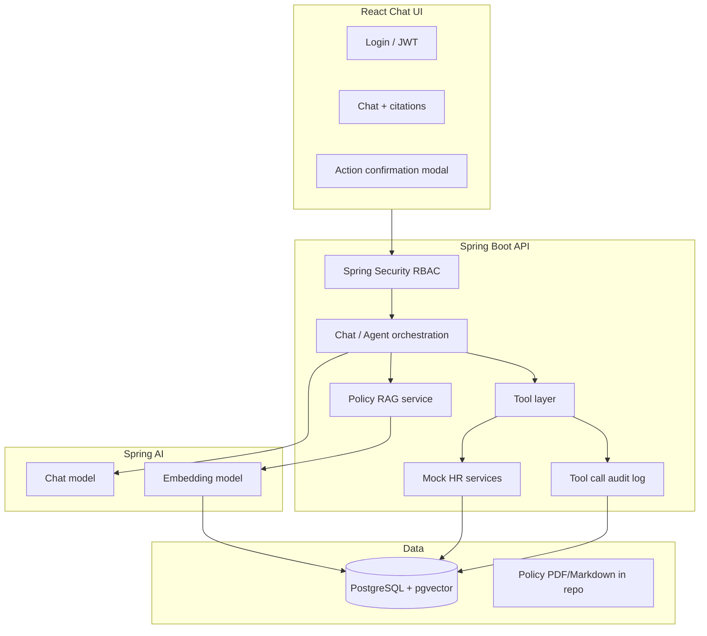

# HR Policy Assistant + Action Agent — Project Plan (v2)

Portfolio / interview project: **RAG over HR policies** plus an **action agent** with tool calling, RBAC, and user confirmation for write operations.

> **Confidentiality:** Do not use ZingHR or any real employer code/data. Use **mock APIs**, **fictional company names** (e.g. Acme Corp), and **policy documents you author**.

> **Changes from v1:** realistic timeline, evaluation harness, larger policy corpus with attribute-based retrieval filtering, security hardening for tools and confirmation, agent safety (iteration limit + audit log), server-side conversation memory, tests as core work, per-phase learning log.

---

## 1. Vision

| Capability | Description |
|------------|-------------|
| **RAG** | Answer questions on leave rules, travel policy, and other HR documents with **citations**. |
| **Agent** | Tools: `getLeaveBalance`, `applyLeave`, `getHolidayList`, `searchHrPolicies` (and optionally `raiseHelpdeskTicket`). |
| **Example** | User: *"Mere kitne leaves bache hain aur kal ka apply kar do"* → agent checks policy context, balance, then proposes leave apply (with confirmation). |
| **Stack** | Spring Boot + Spring AI, pgvector, Spring Security (RBAC), React chat UI. |

**Why this is strong for interviews:** HR domain + RAG + tool calling + RBAC + **measured quality** in one coherent story. You can explain **business rules** (notice period, leave types) and **numbers** (retrieval hit rate, tool-call accuracy), not only tech.

---

## 2. High-level architecture



**Two behaviors in one chat:**

1. **RAG** — retrieve policy chunks → answer + cite document/section.
2. **Agent** — model selects tools → read tools execute immediately; **write tools** create **pending actions** until the user confirms in the UI.

---

## 3. Repository layout

| Path | Purpose |
|------|---------|
| `backend/` | Spring Boot 3.4+, Spring AI, Security, JPA |
| `frontend/` | React (Next) + JavaScript chat UI (keep it thin) |
| `docs/policies/` | **10–15** sample policies (markdown/text you write) |
| `eval/` | Retrieval and agent evaluation sets + runner |
| `docker-compose.yml` | PostgreSQL + pgvector |
| `README.md` | Setup, demo script, eval results, "What I learned" |
| `PROJECT_PLAN.md` | This document |

Monorepo: one clone, one demo narrative.

---

## 4. Backend — logical modules

| Module | Responsibility |
|--------|----------------|
| `security` | JWT login; roles `EMPLOYEE`, `HR_ADMIN`; method-level security |
| `domain` | `Employee` (with grade, location), `LeaveBalance`, `LeaveRequest`, `Holiday`, `PendingAction`, `ToolCallLog`, `ChatSession`, optional `HelpdeskTicket` |
| `mock-hr` | Fake HR APIs backed by DB or seeded data |
| `rag` | Ingest → chunk → embed → `PgVectorStore`; search with metadata filters |
| `agent` | System prompt, Spring AI `@Tool` methods, orchestration, iteration limit |
| `actions` | Pending actions: `APPLY_LEAVE` (and `RAISE_TICKET` if kept); confirm/cancel |
| `eval` | Test sets and runner for retrieval + agent behavior |
| `web` | REST controllers |

### 4.1 REST endpoints (target)

| Method | Path | Role | Purpose |
|--------|------|------|---------|
| POST | `/api/auth/login` | Public | JWT |
| POST | `/api/chat` | `EMPLOYEE+` | Send message (with `conversationId`); response + citations + pending actions |
| POST | `/api/actions/{id}/confirm` | `EMPLOYEE+` | Execute pending write |
| POST | `/api/actions/{id}/cancel` | `EMPLOYEE+` | Discard pending write |
| POST | `/api/admin/policies/ingest` | `HR_ADMIN` | Re-index policy files |

---

## 5. Agent tools

| Tool | Type | Behavior |
|------|------|----------|
| `searchHrPolicies` | RAG | Top-k chunks + metadata for model and UI citations |
| `getLeaveBalance` | Read | Logged-in employee only |
| `getHolidayList` | Read | Filter by year/month |
| `applyLeave` | Write (gated) | Validates rules → **pending action** → apply on confirm |
| `raiseHelpdeskTicket` | Write (gated) | **Optional.** Keep only to show the confirmation pattern generalizes; otherwise cut to reduce scope |

### 5.1 Validation in code (not only in the prompt)

Notice period, leave type, balance, blackout dates, max consecutive days. These are **pure Java rules** with unit tests.

### 5.2 Tool security rules

- **`employeeId` comes only from the JWT / security context.** It is never a tool parameter the LLM can fill in. This blocks prompt injection from reading or acting on another employee's data.
- Every tool call is written to `ToolCallLog` (employee, tool, input, output, timestamp, conversationId).

### 5.3 Agent safety

- **Max iterations limit** on the tool-calling loop so the agent cannot loop forever.
- **Audit log** of every tool call (above) for debugging and for interview answers on "how do you control agents".
- Read tools run directly; **all writes** go through pending actions.

---

## 6. RAG and citations

### 6.1 Ingestion

1. Load files from `docs/policies/`.
2. Split by headings; target chunk size ~500–800 tokens.
3. Metadata: `policyName`, `section`, `sourceFile`, `effectiveDate`, `grade` (if applicable), `location` (if applicable).
4. Embed and store in **pgvector** via Spring AI `PgVectorStore`.

### 6.2 Policy corpus (why 10–15 files)

A handful of small files would fit in the model's context window, which makes RAG look unnecessary. Write a corpus where retrieval actually matters:

- 10–15 policies (leave, travel, expense, WFH, code of conduct, holidays, notice period, etc.).
- **Effective dates / versions** (older and newer version of the same policy).
- **Grade- or location-specific rules** (e.g. travel advance limits differ by grade).
- Some **overlapping sections** across policies so retrieval has to pick correctly.

### 6.3 Query

- Similarity search with a **metadata filter derived from the logged-in employee's attributes** (grade, location), plus optional topic filter (e.g. travel vs leave). This ties RBAC/identity to RAG.
- Pass retrieved chunks to the model with instruction: **only answer from provided context; say so if the context lacks the answer**.

### 6.4 Citations

- **Citations are built server-side from retrieval metadata**, not parsed from the model's text. The model never invents a source name.

### 6.5 API response shape (conceptual)

```json
{
  "conversationId": "uuid",
  "message": "You have 8 casual leave days remaining...",
  "citations": [
    {
      "source": "leave-policy.md",
      "section": "Casual Leave",
      "snippet": "..."
    }
  ],
  "pendingActions": [
    {
      "id": "uuid",
      "type": "APPLY_LEAVE",
      "summary": "Casual leave on 2026-11-15",
      "details": { }
    }
  ]
}
```

### 6.6 Ingestion triggers

- Startup job if vector store is empty (dev convenience).
- HR admin endpoint to re-ingest after policy updates.

---

## 7. Chat + confirmation flow

**Example:** *"Kitne leaves bache hain aur kal ka apply kar do."*

1. Client sends message + `conversationId` with JWT → backend resolves `employeeId` from the token.
2. Agent calls `getLeaveBalance` → includes balance in reply.
3. Agent calls `applyLeave` → backend validates → returns **pending action** (no DB write yet).
4. UI shows **Confirm / Cancel**.
5. `POST /api/actions/{id}/confirm` → backend **re-validates**, persists leave via mock HR → success message in chat.

**Rule:** Read-only tools run without confirmation; all writes require explicit user confirmation.

### 7.1 Confirmation hardening

On `confirm`, the backend must:

- Verify the pending action **belongs to the authenticated user**.
- Verify it is **not expired** (e.g. short TTL) and still `PENDING`.
- Load the payload **from the server-side record**, never from the client.
- **Re-run validation** (balance or rules may have changed since the proposal).
- Be **idempotent**: a double-click or retry must not apply the leave twice.

---

## 8. Spring Security (RBAC)

| Role | Permissions |
|------|-------------|
| `EMPLOYEE` | Chat, own balance/leave, own helpdesk tickets |
| `HR_ADMIN` | Above + policy ingest; optional view all tickets |

- JWT in `Authorization: Bearer`.
- Demo: store token in memory or `sessionStorage` (not long-lived production cookies for MVP).
- Identity for tools and retrieval filters always comes from the security context.

---

## 9. Technology choices

| Layer | Choice |
|-------|--------|
| Runtime | Java **21**, Spring Boot **3.4.x** |
| AI | Spring AI **1.0.x** BOM |
| Chat + embeddings | **Gemini (free tier)** for MVP chat + embeddings. **Ollama** optional later (local); do not dual-run both in MVP — embedding dimensions differ on switch |
| Vector store | `spring-ai-starter-vector-store-pgvector` |
| Transactional data | Same PostgreSQL, JPA |
| Frontend | React 18, Vite, TypeScript |
| API | REST JSON; SSE streaming optional later |
| Testing | JUnit 5, Mockito, **Testcontainers** (pgvector) |

### 9.1 Maven dependencies (reference)

- `spring-boot-starter-web`
- `spring-boot-starter-security`
- `spring-boot-starter-data-jpa`
- `spring-ai-bom` (import)
- `spring-ai-starter-model-openai` (or the chosen provider's starter)
- `spring-ai-starter-vector-store-pgvector`
- `postgresql`
- `testcontainers` (test scope)

---

## 10. Mock data (safe for demos)

- **Users:** e.g. `priya.employee` / `admin.hr` with BCrypt passwords in seed SQL; include different grades/locations so retrieval filtering is demonstrable.
- **Data:** Fixed leave balances, 2026 holiday calendar, 10–15 generic policy markdown files.
- **Branding:** Fictional company only; no real employee IDs or proprietary policy text.

---

## 11. Evaluation (core deliverable)

Quality must be **measured**, not eyeballed.

### 11.1 Retrieval eval

- 25–30 question → expected source/section pairs.
- Metrics: **hit rate @k** (is the right chunk in top-k?), and notes on failures.
- Re-run after every change to chunk size, overlap, top-k, or filters. Record results in the README.
- Include grade/location-specific and versioned-policy questions.
- If the MVP is bilingual: add Hinglish queries against English policies.

### 11.2 Agent eval

- 20–30 scenarios → expected tool(s) and arguments (e.g. "balance only", "apply leave", "policy question must call `searchHrPolicies`", "attempt to act for another employee must fail").
- Metrics: **tool-call accuracy**, and number of scenarios that wrongly executed or skipped a write.
- Include adversarial prompts (prompt injection, requests for other users' data).

### 11.3 Reporting

README table: eval set size, metric, result, what changed between runs.

---

## 12. Phased delivery

**Realistic estimate: 5–7 weeks part-time** (RAG and agent phases carry the learning time; keep the UI thin).

### Phase 0 — Environment (~½ day)

- [ ] JDK 21, Maven, Docker Desktop, Node 20+
- [ ] `docker compose up` → Postgres + pgvector
- [ ] Hosted LLM API key (one provider)

### Phase 1 — Walking skeleton (2–3 days)

- [ ] Spring Boot app, health, CORS
- [ ] JWT login
- [ ] React login + chat shell
- [ ] Verify pgvector schema initialization
- [ ] Learning log: how LLM chat calls work (tokens, context window, system prompt, temperature)

### Phase 2 — Mock HR + read tools (1 week)

- [ ] JPA entities + seed data (employees with grade/location)
- [ ] `getLeaveBalance`, `getHolidayList`
- [ ] ChatClient + `@Tool` wiring (no RAG yet)
- [ ] `employeeId` from security context only
- [ ] Server-side `conversationId` / chat memory
- [ ] `ToolCallLog` table + logging
- [ ] Learning log: how tool calling works

### Phase 3 — RAG + citations (1.5–2 weeks)

- [ ] Write 10–15 policies under `docs/policies/` (versions, grade/location rules, overlaps)
- [ ] Ingestion pipeline with metadata
- [ ] `searchHrPolicies` with employee-attribute metadata filter
- [ ] Server-side citation payload to UI
- [ ] **Retrieval eval set (25–30) + runner + first results**
- [ ] Tune chunk size / overlap / top-k using eval results
- [ ] Learning log: embeddings, vector search, chunking trade-offs

### Phase 4 — Write tools + confirmation + agent safety (1–1.5 weeks)

- [ ] `PendingAction` entity + APIs
- [ ] `applyLeave` validation (pure Java rules)
- [ ] Confirmation hardening (ownership, expiry, re-validate, idempotency)
- [ ] Max iterations limit
- [ ] React confirmation modal
- [ ] **Agent eval set (20–30) + runner + first results**
- [ ] Learning log: agent loop, guardrails, why LLM output is non-deterministic

### Phase 5 — Tests + portfolio polish (1 week)

- [ ] Unit tests for leave rules (notice period, balance, blackout, max consecutive days)
- [ ] Integration tests with Testcontainers (pgvector): ingest + search, confirm flow, idempotency
- [ ] Security tests: another employee's data, expired/foreign pending action
- [ ] Validation error UX, admin ingest UI
- [ ] README: architecture, eval results table, **demo script**, "What I learned"
- [ ] Optional: Actuator metrics

---

## 13. Interview talking points

| Topic | What to say |
|-------|-------------|
| **Why RAG** | Policies change and differ by grade/location; retrieval + citations reduce hallucination and support audit. |
| **Why not just stuff the context** | Corpus has versions, overlaps and attribute-specific rules; filtering plus top-k keeps answers precise and cheaper. |
| **Why tools** | Balances and transactions must come from **systems of record**, not the LLM. |
| **Why confirmation** | HR writes are high-impact; human-in-the-loop, re-validated on confirm, idempotent. |
| **Why RBAC / identity from JWT** | The LLM can never choose whose data it acts on; closes prompt-injection paths. |
| **How you controlled the agent** | Iteration limit, audit log of every tool call, validation in Java, write gating. |
| **How you measured quality** | Retrieval hit rate@k and tool-call accuracy on fixed eval sets; show before/after tuning numbers. |
| **Trade-offs** | Chunk size, top-k, hybrid RAG + tool routing, **validation in Java** vs prompt-only, single hosted provider vs local models. |

---

## 14. Decisions

| # | Decision | Status |
|---|----------|--------|
| 1 | LLM provider | **Decided: Gemini free tier** (now). Ollama downloading in background for later/local use |
| 2 | UI language | English MVP vs bilingual (if bilingual, add Hinglish retrieval tests) — **decide before Phase 3** |
| 3 | Build tool | Maven (default here) vs Gradle — **decide before Phase 1** |
| 4 | Streaming | Defer to after Phase 5 |
| 5 | Conversation memory | **Decided:** server-side `conversationId` in DB |
| 6 | `raiseHelpdeskTicket` | Keep (to show pattern reuse) or cut — **decide before Phase 4** |

---

## 15. Suggested build order

1. Docker + `application.yml`
2. Security + seed users
3. Mock leave / holiday services
4. ChatClient + read-only tools + audit log + conversation memory
5. Policy corpus + RAG ingest + citations + retrieval eval
6. Pending actions + React confirm flow + agent eval
7. Tests, README, demo script

---

## 16. Demo script (5 minutes)

1. Login as employee → ask *"What is the travel advance limit?"* → show **citation** from the right grade-specific travel policy.
2. Ask *"How many casual leaves do I have?"* → tool shows balance.
3. Ask *"Apply casual leave for tomorrow"* → **pending action** card → Confirm → success.
4. Try to act on another employee's data → show it is refused.
5. Show the **eval results table** (retrieval hit rate, tool-call accuracy).
6. Login as HR admin → trigger policy re-ingest (optional).
7. One sentence each: RAG, tools, RBAC, confirmation, evaluation.

---

## 17. Next step

When ready to implement, say **"start Phase 1"** and confirm:

- **Gemini** (free API key) — primary for MVP
- Ollama — optional later when install finishes
- Maven vs Gradle
- English-only vs bilingual MVP

No application code until you explicitly ask to begin a phase.